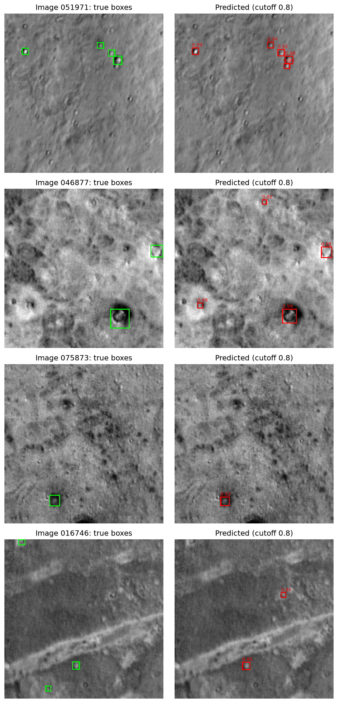
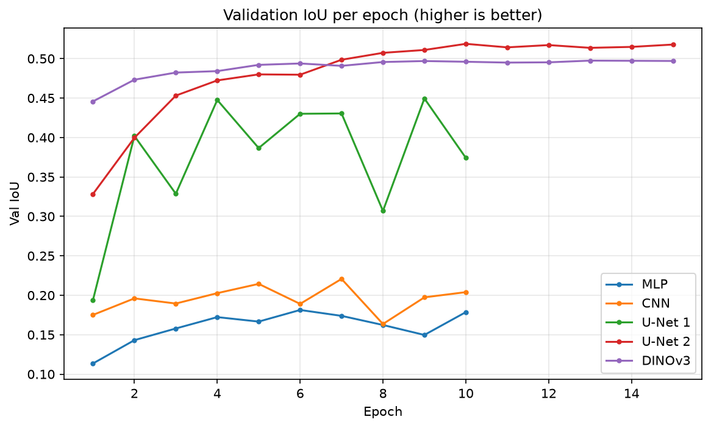
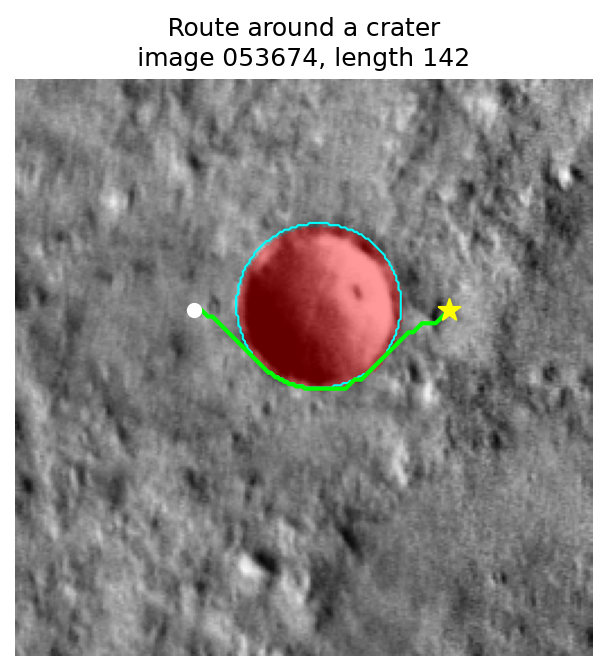

# Something in the Way

### Deep Learning for Crater Detection and Crater-Aware Route Planning on Mars

*Which deep learning model finds Martian craters best, and do its mistakes matter for a rover?*

[](https://www.python.org/)
[](https://pytorch.org/)
[](paper/something-in-the-way.pdf)

**Enes Demirel** · CSC 383 Deep Learning, final project · DePaul University, Fall 2026

> [!NOTE]
> 📄 **This project comes with a paper:** [Read the paper (PDF)](paper/something-in-the-way.pdf) · [LaTeX source](main.tex)

<p align="center">
  
</p>
<p align="center"><em>Overview of the pipeline: a crater detector turns an orbital satellite image into a map of craters. Rover 1 plans its full route on this map with A*, while Rover 2 is a small network that only sees a 15 × 15 window around itself. Both start at the white circle and drive to the star.</em></p>

---

## Contents

- [TL;DR](#tldr)
- [Research questions](#research-questions)
- [Dataset](#dataset)
- [Methods](#methods)
- [Results](#results)
- [Key findings](#key-findings)
- [Limitations and future work](#limitations-and-future-work)
- [Repository structure](#repository-structure)
- [Reproducing the results](#reproducing-the-results)
- [Citation](#citation)
- [Acknowledgments](#acknowledgments)
- [License](#license)

---

## TL;DR

It takes approximately 4 to 22 minutes for a signal to reach Mars; therefore, Mars rovers are increasingly driven autonomously. To do this, it is important for these rovers to be able to recognize dangers such as craters without help from Earth. In this project, we study two questions: (1) which type of deep learning model performs best at detecting craters in orbital images of Mars, and (2) whether the model's mistakes matter for rovers. Using about 52,000 labeled satellite images, we compare three models: a U-Net trained from scratch, a Faster R-CNN fine-tuned from a model trained on everyday objects, and a frozen DINOv3 foundation model with only a small layer trained on top. We find that Faster R-CNN performs best with an F1 score of 0.80, while U-Net achieves 0.57 and DINOv3 0.21. We also show that it is important to use multiple scoring methods in crater detection, as pixel-based scores can make very different models appear equally good. We then use the best detector's map to drive two simulated rovers. Rover 1 plans its full route with A*, while Rover 2 is a small neural network that learns to drive from A*'s moves, only seeing the area around itself. Both reach their goals on all 1,000 test routes, but most of the crater entries come not from missed craters, but from detected craters with slightly wrong outlines.

## Research questions

1. **Which kind of model detects craters best?** A model trained from scratch (U-Net), a model fine-tuned from everyday-object detection (Faster R-CNN), or a frozen foundation model with a small trained head (DINOv3)?
2. **Do the detector's mistakes matter for a rover?** A missed crater can lead a rover straight into it, while a false crater only makes the route a little longer.

## Dataset

| | |
|---|---|
| Source | [2022 GeoAI Martian Challenge](https://cici.lab.asu.edu/martian/) (ASU CICI Lab) |
| Labels | Robbins & Hynek (2012) Mars crater catalog |
| Images | 51,838 labeled 256 × 256 grayscale orbital images (~100 m per pixel) |
| Crater boxes | 152,523 |
| Split (80/10/10) | 41,470 train / 5,184 val / 5,184 test, scikit-learn `train_test_split` with `random_state=0` ([`dataset/split.json`](dataset/split.json)) |
| Label file | [`dataset/gt_public.json`](dataset/gt_public.json): `{image_id: [[x, y, w, h], ...]}` |
| Class balance | only ~2% of pixels are crater |

> [!IMPORTANT]
> The images are **not** included in this repository (they are git-ignored, ~2.3 GB). Download them from the [challenge page](https://cici.lab.asu.edu/martian/) and place them in `dataset/images/`.

For the segmentation models, each box is converted into a filled circle centered at the same point, with a radius equal to half the box's longer side; these circles form the target mask. Faster R-CNN uses the original boxes.

## Methods

### Crater detectors

| Model | Approach | Trained parameters | Output |
|---|---|---:|---|
| MLP (baseline) | from scratch, 16 × 16 patches | 525,568 | pixel mask |
| CNN (baseline) | from scratch, 8 convolutions, no downsampling | 166,593 | pixel mask |
| **U-Net** | from scratch, encoder-decoder with skip connections | 1.9M | pixel mask |
| **Faster R-CNN** | ResNet-50-FPN fine-tuned from COCO, new 2-class head, kept at 256 px | 41.1M | boxes + scores |
| **DINOv3** | frozen ViT-S/16 + 1 × 1 conv head on 16 × 16 patch features | 385 | patch scores, upsampled to 256 × 256 |

For the U-Net and DINOv3, each connected group of crater pixels becomes one predicted crater, so every model can be scored the same way. Grayscale images are copied into three channels for the pretrained models.

### Training settings

| Model | Loss | Optimizer | Learning rate | Epochs | Batch size |
|---|---|---|---|---:|---:|
| U-Net | weighted BCE (crater weight w = 10) | Adam | 10⁻³, cosine | 15 | 16 |
| Faster R-CNN | detection losses | SGD (momentum 0.9, weight decay 5 × 10⁻⁴) | 5 × 10⁻³, cosine | 15 | 8 |
| DINOv3 head | weighted BCE (w = 10) | Adam | 10⁻³, cosine | 15 | 64 |
| MLP, CNN (baselines) | weighted BCE (w = 10) | Adam | 10⁻³, constant | 10 | 16 |

All detectors were trained on an NVIDIA RTX 5090. For each model, the weights and cutoff with the best validation score are kept; all reported numbers are on the test set.

### Evaluation

- **Pixel IoU**: overlap between the predicted and true crater masks.
- **Per-crater precision / recall / F1**: a predicted crater matches a real one if their boxes have IoU ≥ 0.5; each real crater can be matched only once.

### Rovers

Both rovers drive on a 256 × 256 grid built from the Faster R-CNN crater map (cutoff 0.8), using 8 moves (cost 1 straight, √2 diagonal).

| | Rover 1 | Rover 2 |
|---|---|---|
| Method | A* on the full detected crater map | Behavior-cloned MLP that imitates A* |
| Sees | the whole map | a 15 × 15 window + the direction to the goal |
| Details | octile-distance heuristic, plans the whole route before moving | 227 → 128 (ReLU) → 8, 30,216 parameters; trained on A* moves on the true crater map |

## Results

### Crater detection (test set)

| Model | Precision | Recall | F1 | Pixel IoU |
|---|---:|---:|---:|---:|
| MLP | 0.067 | 0.316 | 0.110 | 0.176 |
| CNN | 0.031 | 0.634 | 0.059 | 0.215 |
| U-Net | 0.481 | 0.703 | 0.571 | **0.511** |
| **Faster R-CNN** | **0.795** | **0.803** | **0.799** | – |
| DINOv3 | 0.306 | 0.158 | 0.209 | 0.508 |

<sub>Pixel IoU uses each model's pixel cutoff chosen on validation (0.8 for U-Net and DINOv3, 0.5 for the baselines). Faster R-CNN predicts boxes, so it has no pixel IoU. Raw numbers: <code>src/*/*/test_scores.json</code>.</sub>

<p align="center">
  
</p>
<p align="center"><em>Faster R-CNN on test images: true craters in green, predicted craters in red (cutoff 0.8).</em></p>

<table>
  <tr>
    <td align="center" width="50%"><br><em>U-Net (pixel IoU 0.511, F1 0.571)</em></td>
    <td align="center" width="50%"><br><em>DINOv3 (pixel IoU 0.508, F1 0.209)</em></td>
  </tr>
</table>
<p align="center"><em>The same four test images. U-Net and DINOv3 reach almost the same pixel IoU, but U-Net finds far more individual craters.</em></p>

<p align="center">
  
</p>
<p align="center"><em>Validation pixel IoU per epoch for the mask-based models (MLP, CNN, both U-Net runs, DINOv3).</em></p>

### Rovers (1,000 test routes)

| | Rover 1 (A*, full map) | Rover 2 (MLP, 15 × 15 window) |
|---|---:|---:|
| Reached the goal | 100% | 100% |
| Routes that entered a crater | 9.3% | 11.2% |
| Craters entered | 100 | 117 |
| ↳ missed by the detector | 32 | 23 |

<p align="center">
  
</p>
<p align="center"><em>Example routes. Top row: Rover 1 (solid blue). Bottom row: Rover 2 (dashed orange). Both start at the white circle and drive to the star.</em></p>

<details>
<summary>Close-up: Rover 1 routing around a crater</summary>
<p align="center">
  
</p>
</details>

## Key findings

- **Faster R-CNN is the best and most balanced detector** (F1 0.799, with precision and recall both near 0.80).
- **U-Net has high recall but low precision** (0.703 / 0.481): its masks contain many small false blobs.
- **DINOv3 misses most craters** (recall 0.158), likely because its 16 × 16 patches blend small craters into the surrounding ground.
- **Use more than one metric.** U-Net and DINOv3 have nearly identical pixel IoU (0.511 vs 0.508), yet U-Net's F1 is almost 3× higher (0.571 vs 0.209).
- **Both rovers reach the goal on all 1,000 routes.**
- **Outline precision matters as much as detection.** Most crater entries are into craters the detector *did* find but outlined slightly wrong (Rover 1: 68 of 100 entries).

## Limitations and future work

**Limitations**
- Faster R-CNN was trained at 256 × 256 instead of its usual 800 × 800, to keep training fast.
- DINOv3 was kept frozen, which likely hurt it on small craters.
- Labels are boxes turned into circles, so they only approximate real crater shapes.
- Many small craters are unlabeled; correct detections of them count as false positives and lower precision.
- The rover simulation is simple, and Rover 2 only copies A*, so it never learns to recover from its own mistakes.

**Future work**
- Train Faster R-CNN on enlarged images.
- Fine-tune DINOv3 instead of freezing it.
- Add a small safety margin around detected craters.
- Train Rover 2 with a method that learns from its own mistakes (e.g. DAgger-style data aggregation).

## Repository structure

```text
something-in-the-way/
├── README.md
├── requirements.txt
├── main.tex, math_commands.tex, refs.bib   # paper LaTeX source (uses figures/)
├── paper/
│   └── something-in-the-way.pdf            # compiled paper
├── docs/
│   └── appendix-data.md                    # raw numbers collected for the appendix
├── dataset/
│   ├── gt_public.json                      # crater boxes per image
│   ├── split.json                          # train / val / test image ids
│   └── images/                             # git-ignored, download separately
├── figures/
│   ├── make_pipeline.py                    # -> pipeline.pdf / pipeline.png
│   ├── make_rover_routes.py                # -> rover_routes.pdf / rover_routes.png
│   └── pipeline.*, rover_routes.*
├── src/                                    # one folder per model / rover, one subfolder per run
│   ├── mlp/  cnn/  unet/  faster-rcnn/  dinov3/  rover-1/  rover-2/
│   │   └── <run>/   history.json, notes.txt, curves.png, predictions.png,
│   │                test_scores.json, crater_scores.json, weights (*.pt)
│   └── comparison/                         # comparison tables (.csv / .tex) and curves
├── something-in-the-way.ipynb              # main notebook: every step end-to-end (start here)
└── 01-... to 10-....ipynb                  # step-by-step notebooks (see below)
```

> Faster R-CNN weights (`src/faster-rcnn/**/model.pt`, 158 MB) are git-ignored because they exceed GitHub's file size limit.

### Notebooks

| Notebook | Purpose |
|---|---|
| **[`something-in-the-way.ipynb`](something-in-the-way.ipynb)** | **Main consolidated notebook with every step end-to-end. Read this first.** |
| [`01-clear-the-dataset.ipynb`](01-clear-the-dataset.ipynb) | Delete unlabeled images from `dataset/images/` |
| [`02-visualize-the-dataset.ipynb`](02-visualize-the-dataset.ipynb) | Explore images, crater boxes and masks |
| [`03-mlp.ipynb`](03-mlp.ipynb) | Train the MLP baseline |
| [`04-cnn.ipynb`](04-cnn.ipynb) | Train the plain CNN baseline |
| [`05-unet.ipynb`](05-unet.ipynb) | Train the U-Net from scratch |
| [`06-faster-rcnn.ipynb`](06-faster-rcnn.ipynb) | Fine-tune Faster R-CNN |
| [`07-dinov3.ipynb`](07-dinov3.ipynb) | Train the head on frozen DINOv3 features |
| [`08-compare.ipynb`](08-compare.ipynb) | Build comparison tables and curves (`src/comparison/`) |
| [`08-rover-1.ipynb`](08-rover-1.ipynb) | Rover 1: A* on the detected crater map |
| [`09-rover-2.ipynb`](09-rover-2.ipynb) | Rover 2: behavior-cloned MLP |
| [`10-test-scores.ipynb`](10-test-scores.ipynb) | Final test-set scores for all detectors |

The two `08-` notebooks are independent of each other (detector comparison vs. Rover 1).

## Reproducing the results

```bash
git clone https://github.com/enesdemirelus/something-in-the-way.git
cd something-in-the-way
pip install -r requirements.txt
```

1. **Get the data.** Download the images from the [GeoAI Martian Challenge](https://cici.lab.asu.edu/martian/) and put them in `dataset/images/`.
2. **Start Jupyter from the repository root.** All paths in the notebooks are relative to the root.
3. **Run the notebooks**, either `something-in-the-way.ipynb` end-to-end or `01` through `10` in order.

> [!WARNING]
> `01-clear-the-dataset.ipynb` and an early cell in `something-in-the-way.ipynb` **delete** every unlabeled image from `dataset/images/`. This is intended (the challenge's test images have no labels) and only needs to run once.

**Notes**
- **Faster R-CNN weights are not included** (158 MB, over GitHub's limit). Re-train them with `06-faster-rcnn.ipynb`. The rover notebooks and the figure scripts depend on them.
- **DINOv3** is loaded from Hugging Face (`facebook/dinov3-vits16-pretrain-lvd1689m`) and the notebook calls `huggingface_hub.login()`, so you need a Hugging Face account with access to the model.
- **Device** is picked automatically: CUDA, then Apple MPS, then CPU.
- **Figures:**
  ```bash
  python figures/make_pipeline.py
  python figures/make_rover_routes.py
  ```
- **Paper:** compile `main.tex` with XeLaTeX + BibTeX (`xelatex main && bibtex main && xelatex main && xelatex main`).

## Citation

```bibtex
@misc{demirel2026something,
  author       = {Enes Demirel},
  title        = {Something in the Way: Deep Learning for Crater Detection and Crater-Aware Route Planning on Mars},
  year         = {2026},
  howpublished = {\url{https://github.com/enesdemirelus/something-in-the-way}},
  note         = {CSC 383 Deep Learning final project, DePaul University}
}
```

## Acknowledgments

- Dataset: the [2022 GeoAI Martian Challenge](https://cici.lab.asu.edu/martian/) by the ASU CICI Lab.
- Crater labels: the Robbins & Hynek (2012) global Mars crater catalog.
- Models: [DINOv3](https://github.com/facebookresearch/dinov3) by Meta AI, and the Faster R-CNN implementation in [torchvision](https://pytorch.org/vision/).

> Model training ran on my brother's workstation (NVIDIA RTX 5090), and some commits were originally pushed from that machine. If an extra contributor ever shows up in GitHub's cached contributor list, it only reflects whose computer was used, not authorship. All work in this repository is my own.

## License

No license has been chosen yet, so all rights are reserved by default.
