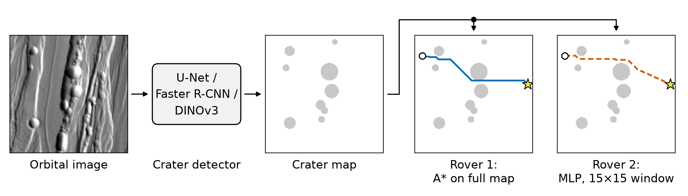
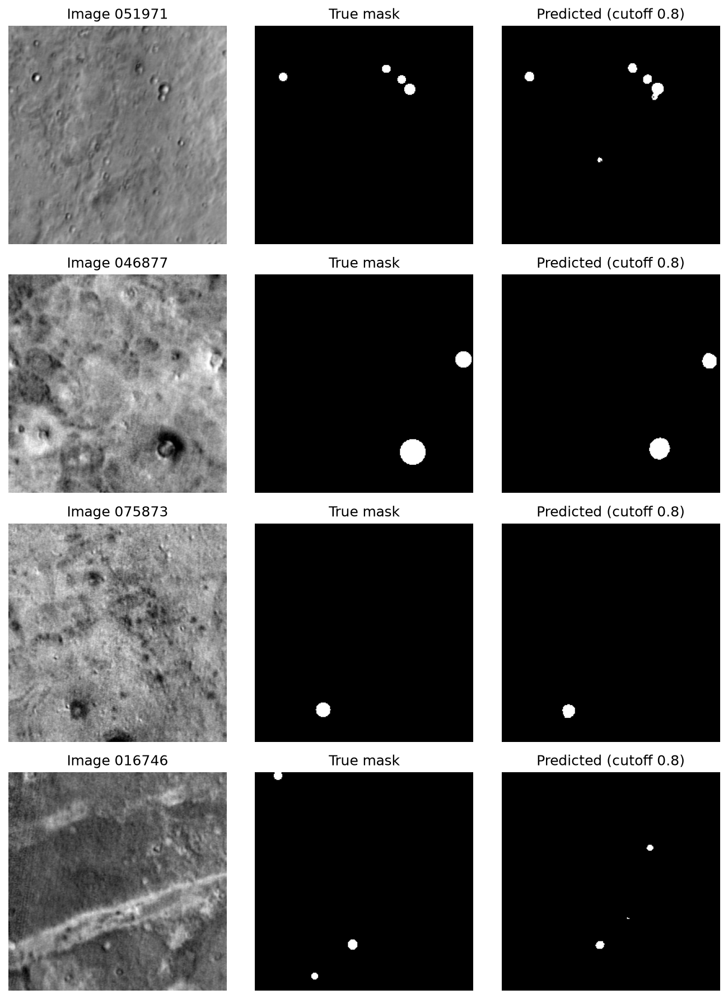
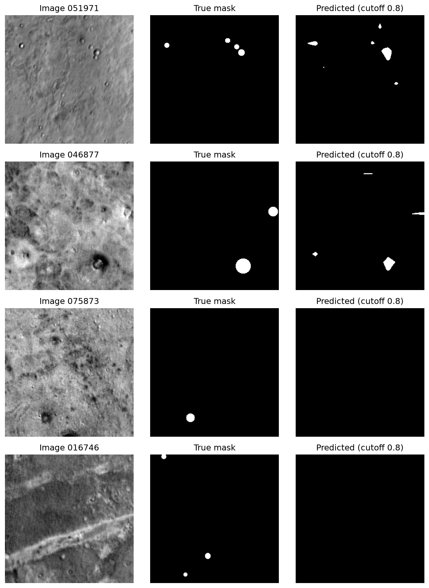
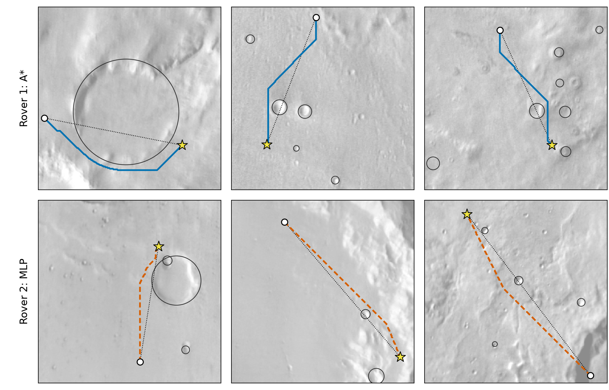

# Something in the Way

**Deep Learning for Crater Detection and Crater-Aware Route Planning on Mars**

Final project for CSC 383 (Deep Learning) at DePaul University, Fall 2026 · Enes Demirel

📄 **There is a paper for this project:** [read it here (PDF)](paper/something-in-the-way.pdf) · [LaTeX source](main.tex)

<p align="center">
  
</p>

## What is this?

Mars rovers can't be driven live from Earth (signals take 4–22 minutes), so they need to spot dangers like craters on their own. In this project I tried to answer two questions:

1. **Which kind of model finds craters best** in orbital images of Mars?
2. **Do the model's mistakes actually matter** for a rover driving across the map?

I compared three approaches (plus an MLP and a CNN as baselines):

- **U-Net**, trained from scratch
- **Faster R-CNN**, fine-tuned from a COCO-pretrained model
- **DINOv3**, a frozen foundation model with a tiny trained head on top

Then I used the best detector's crater map to drive two simulated rovers: **Rover 1** plans its whole route with A*, and **Rover 2** is a small neural network that learned to drive by copying A*, only seeing a 15×15 window around itself.

## Dataset

~52,000 labeled 256×256 grayscale images of Mars from the [2022 GeoAI Martian Challenge](https://cici.lab.asu.edu/martian/), with about 152,000 crater boxes. Split 80/10/10 into train/val/test ([`dataset/split.json`](dataset/split.json)).

The images aren't in this repo (~2.3 GB). Download them and put them in `dataset/images/`.

## Results

**Crater detection (test set)**

| Model | Precision | Recall | F1 | Pixel IoU |
|---|---:|---:|---:|---:|
| MLP (baseline) | 0.067 | 0.316 | 0.110 | 0.176 |
| CNN (baseline) | 0.031 | 0.634 | 0.059 | 0.215 |
| U-Net | 0.481 | 0.703 | 0.571 | **0.511** |
| **Faster R-CNN** | **0.795** | **0.803** | **0.799** | – |
| DINOv3 | 0.306 | 0.158 | 0.209 | 0.508 |

<table>
  <tr>
    <td align="center" width="50%"><br><em>U-Net</em></td>
    <td align="center" width="50%"><br><em>DINOv3</em></td>
  </tr>
</table>

U-Net and DINOv3 get almost the same pixel IoU, but U-Net finds far more actual craters, so one metric alone can be misleading.

**Rovers (1,000 test routes)**

| | Rover 1 (A*) | Rover 2 (neural net) |
|---|---:|---:|
| Reached the goal | 100% | 100% |
| Routes that entered a crater | 9.3% | 11.2% |
| Craters entered (missed by detector) | 100 (32) | 117 (23) |

<p align="center">
  
</p>
<p align="center"><em>Top: Rover 1. Bottom: Rover 2. Both start at the white circle and drive to the star.</em></p>

## Takeaways

- **Faster R-CNN was the clear winner** (F1 ≈ 0.80).
- **Use more than one metric.** Pixel IoU made U-Net and DINOv3 look equal, but per-crater F1 showed a big gap.
- **Both rovers always reached the goal.** Most crater hits came from craters the detector *did* find but outlined slightly wrong, not from missed ones.

More details, limitations and future work are in the [paper](paper/something-in-the-way.pdf).

## Repo layout

```text
something-in-the-way.ipynb   # main notebook, everything end-to-end (start here)
01-... to 10-....ipynb       # the step-by-step notebooks I worked in
src/                         # results for each model/rover run (scores, curves, predictions, weights)
figures/                     # figure scripts + figures used in the paper
dataset/                     # labels + train/val/test split (images not included)
paper/                       # compiled paper (PDF)
main.tex, refs.bib           # paper source
```

## Running it

```bash
pip install -r requirements.txt
```

Put the images in `dataset/images/`, start Jupyter **from the repo root** (paths are relative to it) and run `something-in-the-way.ipynb`.

A few notes:
- The Faster R-CNN weights (158 MB) are too big for GitHub, so you'll need to retrain them with `06-faster-rcnn.ipynb`.
- `01-clear-the-dataset.ipynb` (and an early cell in the main notebook) deletes the unlabeled images from `dataset/images/`. That's on purpose.
- DINOv3 is downloaded from Hugging Face, so you need an account with access to it.

## Note on contributors

I trained the models on my brother's PC because it has an RTX 5090. Some commits were pushed from his machine, so if he ever shows up as a contributor, that's why. The project itself is my own work.
